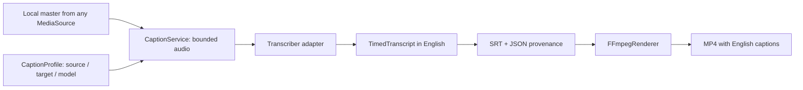

# English captions and clip titles

The clipping workflow produces proposed titles and generated subtitles in English,
including when the original speech is in another supported language. The app UI
can remain Portuguese.



`caption_models.py` contains `CaptionProfile`, `SubtitleCue` and `TimedTranscript`.
`speech_transcriber.py` contains the `Transcriber` interface and current
`WhisperTranscriber` adapter. `caption_service.py` handles audio extraction,
timing validation, readable line lengths and subtitle artifacts. The renderer
accepts an injected service; the service accepts an injected provider. A future
provider can combine ASR and a separate text translator while returning the same
`TimedTranscript`, without changing the renderer or source adapters.

## Current backend and configuration

Whisper's multilingual models translate speech directly to English with
`task="translate"`. `language=None` detects the spoken language; `language="pt"`
explicitly identifies Portuguese input. Explicit English input uses
`task="transcribe"`. Forcing `language="en"` on Portuguese speech is not translation.

```json
{
  "renderProfile": {
    "aspect": "9:16", "fit": "pad", "captions": true,
    "captionProfile": {
      "sourceLanguage": "auto", "targetLanguage": "en", "model": "small"
    }
  }
}
```

Older requests with only `captions: true` receive these English defaults. Rust
omits the default nested profile when serializing, preserving the old JSON shape.
The UI labels the option **Legendas em inglês** and supports detection or an
explicit speech language.

The initial target is `en`; other targets fail explicitly. The model defaults to
multilingual `small`; `tiny`, `base`, `medium` and `large-v3` are also accepted.
English-only `.en` models and `turbo` are rejected for this translation workflow.
Another output language needs a capable provider and corresponding validation/UI.

Install with `Setup-Media.ps1 -Captions`. Model weights are downloaded once and
cached locally; inference runs on the local CPU. Optional requirements constrain
PyAV below 19 because faster-whisper 1.2.x calls the `metadata_errors` argument
removed in PyAV 19, as verified in a real model test.

Primary references: [Whisper speech translation](https://github.com/openai/whisper#command-line-usage)
and [faster-whisper options](https://github.com/SYSTRAN/faster-whisper/blob/master/faster_whisper/transcribe.py).

## Timing, provenance and limits

SRT timestamps are relative to the clip. JSON stores the detected source language
separately from the output language, provider/model/task, input media file and
input-file interval. The production manifest retains the source URL and absolute
cut interval, plus paths to the caption artifacts.

Cues stay inside the clip and do not overlap. Text wraps at 42 characters, with
at most two lines per cue. Longer model segments are divided proportionally and
that timing method is recorded; this is not word-level alignment. Silence returns
`no_speech`; a video without audio returns `no_audio`. Provider errors fail that
clip and remain visible for retry. Translation quality varies with noise, accents
and overlapping speakers; human review is still needed.

Titles in the daily review are currently editorial metadata prepared by the
workflow, not an automatic app title generator. Keep them in English. A future
`TitleGenerator` should consume the English `TimedTranscript` and return an
English title with provenance, independently of rendering and source adapters.

Timed source subtitles/transcripts used to **select moments** remain separate
work in [issue #3](https://github.com/TomasPedreira/ChatScope/issues/3). English
output captions for an already selected clip do not implement that detector.
