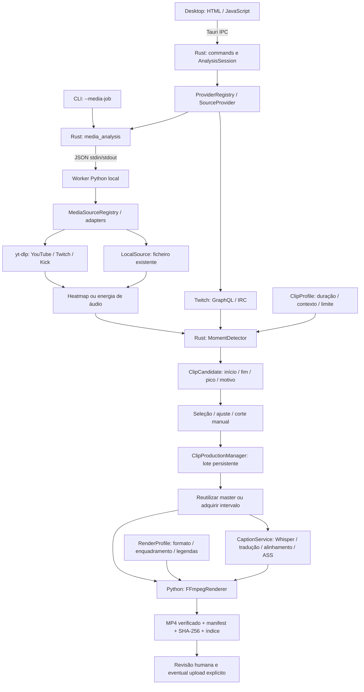

# Guia da arquitetura e do clipping por plataforma

Este guia descreve a implementação existente na branch `kick_scoper`, revista em
2026-11-27. A ChatScope recebe uma fonte, procura sinais de possíveis momentos
relevantes, sugere intervalos e produz MP4 locais para revisão. O utilizador pode
ajustar os intervalos ou definir cortes manualmente antes de produzir.

Um **`ClipCandidate` é uma sugestão temporal**; só passa a existir um ficheiro de
vídeo depois da produção. A escolha final dos melhores clips continua editorial.

## 1. Arquitetura geral



O diagrama apresenta os blocos lógicos. O worker Python executa tanto aquisição
e análise de áudio como produção; o **ranking final de candidatos fica em Rust**.
No modo chat da Twitch, a aquisição e análise do chat ficam em Rust.

### Porque existem Rust, JavaScript e Python?

| Camada | Responsabilidade |
| --- | --- |
| HTML/CSS/JavaScript | Interface, timeline, seleção e controlos de produção. Usa ES modules locais, sem framework. |
| Rust/Tauri | URL routing, validação, sessão, detectors, comandos, lifecycle, cancelamento e persistência dos pedidos. |
| Python | Integração com yt-dlp, aquisição de media, extração de sinais de áudio, Whisper e preparação do rendering. |
| FFmpeg | Download/captura quando necessário, decode, corte, escala, áudio e composição das legendas. |

Python permite reutilizar as integrações de yt-dlp e faster-whisper. A fronteira
com Rust é um protocolo JSON por stdin/stdout, sem servidor HTTP interno. Rust
incorpora os módulos Python no executável e extrai uma runtime com hash do código.
As dependências continuam a exigir o ambiente Python instalado pelo setup.

## 2. Estrutura do repositório e nomes principais

```text
ChatScope/
  Start-ChatScope.ps1           compilar e abrir a desktop app
  apps/chatscope/
    src-tauri/src/             backend Rust
    ui/                        interface HTML/CSS/JavaScript
    pipeline/                  worker Python e serviços de media
    providers/                 adapter histórico de metadados YouTube
    study/                     coletor e ferramentas avançadas/históricas de Shorts
    tests/                     testes Python, UI, native e fixtures
    Setup-Media.ps1             dependências de aquisição/rendering/legendas
    Setup-Kick.ps1              dependência adicional da Kick
  docs/                        arquitetura, configuração e guias operacionais
  media/                       media e resultados locais, ignorados pelo Git
```

Os principais ficheiros Rust estão em `apps/chatscope/src-tauri/src/`:

| Ficheiro | O que procurar aqui |
| --- | --- |
| `main.rs`, `cli.rs`, `commands/` | Arranque, modos CLI e comandos Tauri de análise, produção e export. |
| `source_providers.rs`, `kick_provider.rs` | `SourceProvider`, `ProviderRegistry`, validação de URLs e modos disponíveis por plataforma. |
| `domain_models.rs` | `MediaSource`, `SourceInput`, `SignalPoint`, `VideoAnalysis` e `ClipCandidate`. |
| `analysis_session.rs` | `AnalysisSession`, estado em memória, snapshots e candidatos da sessão. |
| `twitch_chat.rs` | Metadados Twitch, replay GraphQL, IRC live e scoring do chat. |
| `moment_detectors.rs` | `MomentDetector`, `ChatActivityDetector`, `HeatmapDetector` e `AudioEnergyDetector`. |
| `media_analysis.rs`, `media_worker_client.rs` | Pedido ao worker, evidência normalizada, escolha do detector e controlo da árvore de processos. |
| `clip_profiles.rs` | `ClipProfile`, `RenderProfile`, `CaptionProfile` e limites temporais. |
| `clip_production.rs` | `ClipProductionManager`: validação do lote, exclusão entre instâncias, cancelamento e retoma. |
| `production_paths.rs`, `production_store.rs` | Raiz de saída, job IDs, escrita atómica e recuperação do estado. |
| `session_exports.rs`, `source_links.rs` | Exports JSON/CSV e links com timestamps. |

No Python, em `apps/chatscope/pipeline/`:

| Ficheiro ou grupo | Responsabilidade |
| --- | --- |
| `worker.py` | Dispatcher das ações JSON `analyze` e `render`. |
| `source_analysis.py` | Metadados, intervalo, escolha de heatmap ou fallback de áudio e cache de evidência. |
| `media_sources.py`, `kick_source.py` | ABC `MediaSource`, `YtDlpSource`, `LocalSource`, `KickSource` e `MediaSourceRegistry`. |
| `audio_signals.py` | Energia RMS por segundo a partir de áudio decodificado. |
| `clip_production.py` | Execução dos cortes, reutilização/aquisição do master, estados e promoção dos MP4 finais. |
| `video_renderer.py`, `media_tools.py` | `Renderer` / `FFmpegRenderer`, execução de FFmpeg e verificação de media. |
| `caption_models.py`, `caption_service.py` | Perfis e texto temporizado, extração de fala, SRT e proveniência. |
| `speech_transcriber.py`, `transcript_translation.py` | `Transcriber` / `WhisperTranscriber` e contrato `TranscriptTranslator`. |
| `word_alignment.py`, `caption_styling.py`, `caption_style.py` | Texto fixo → tempos das palavras → estilo ASS partilhado. |
| `saved_caption_service.py` | Reutilizar texto aprovado para restyling sem nova transcrição. |
| `request_validation.py`, `job_storage.py`, `review_index.py` | Validação, manifests atómicos e índice de revisão. |

Na UI, `app.js` coordena a sessão e as views; `clip_production_view.js` trata dos
controlos/progresso da produção; `tauri_client.js` concentra IPC e `dom_helpers.js`
os helpers de apresentação.

Os nomes internos usam o domínio e unidades explícitas, como
`duration_seconds`, `seconds_before_peak` e `master_source_offset_seconds`.
Rust/Python usam snake_case, JavaScript camelCase e os tipos PascalCase.
Alguns nomes públicos, como `--scope-youtube`, `open_youtube_moment`, `export_chat`
e o campo `youtube` do snapshot, são compatibilidade com versões anteriores.
O estado genérico atual é `video_analysis`; os aliases não criam outro pipeline.

## 3. Contratos partilhados: como as peças encaixam

| Contrato | Informação ou comportamento |
| --- | --- |
| `SourceProvider` (Rust trait) | Aceitar/normalizar URL, anunciar capabilities e preparar modo chat ou vídeo. |
| `MediaSource` (Rust struct) | Descrever a fonte: URL, plataforma/tipo, ID, título, canal, duração e intervalo. |
| `MediaSource` (Python ABC) | `metadata()` e `acquire(start, end, directory)`; devolve ficheiro local e offset na fonte. É um contrato distinto da struct Rust. |
| `SignalPoint` | Um intervalo `start_time`/`end_time` e um valor numérico de evidência. |
| `MomentDetector<T>` | Converter evidência em candidatos dentro dos limites e do `ClipProfile`. |
| `ClipCandidate` | `start`, `end`, `peak`, `strength`, `signal` e `reason`. |
| `Renderer` | Transformar um ficheiro local e um intervalo num vídeo com o `RenderProfile`; não precisa de conhecer a plataforma. |

Os dois registries têm funções diferentes: Rust escolhe o fluxo da aplicação;
Python escolhe como adquirir os metadados e a media. O renderer é comum a todas
as fontes. Atualmente não há fusão automática de vários sinais: escolhe-se o
modo chat ou vídeo; em vídeo prefere-se heatmap disponível e depois áudio.

`strength` serve para ranking dentro da análise. Não é probabilidade de sucesso,
percentagem de espectadores ou uma pontuação comparável entre plataformas.

## 4. Como se encontram momentos em cada plataforma

| Fonte e modo | Sinal implementado | Timeline e produção |
| --- | --- | --- |
| YouTube vídeo/VOD processado | Heatmap de repetição, se existir; caso contrário áudio | Tempos no vídeo original; download dos cortes ou reutilização do master de análise. |
| YouTube Live | Energia do áudio de uma captura de 30–600 s | Tempos na gravação local; cortes no master capturado. |
| Twitch VOD/clip, modo chat | Reações, mensagens e participantes distintos | Tempos no VOD; clips Twitch resolvem o VOD original. |
| Twitch live, modo chat | Mensagens IRC recebidas durante a sessão | Produz sugestões; este modo não grava o vídeo necessário para MP4. |
| Twitch, modo vídeo/áudio | Energia do áudio | Aquisição comum; live usa master de 30–600 s. |
| Kick live/VOD/clip | Energia do áudio | VOD/clip na timeline da fonte; live na gravação local. |
| Ficheiro local | Energia do áudio | Tempos no ficheiro original, que é preservado. |

### YouTube: vídeos e VODs processados

1. `YouTubeProvider` valida o vídeo e normaliza URLs `watch`, `youtu.be`, `shorts`,
   `embed` e `live` para `watch?v=ID`. Canais/playlists não são entradas de análise.
   Parâmetros como `t=` são removidos; define `start`/`end` explicitamente para
   limitar a análise.
2. `YtDlpSource.metadata()` consulta os metadados sem descarregar o vídeo.
   `source_analysis.py` valida e recorta o heatmap ao intervalo pedido.
3. Se houver pontos de heatmap, Rust aplica `HeatmapDetector`. Nesta fase não é
   necessário adquirir o vídeo.
4. Se o heatmap estiver ausente ou não tiver pontos no intervalo, adquire-se um
   master limitado e calcula-se energia de áudio. **Este fallback aceita até
   600 s por análise**; um vídeo longo precisa de vários intervalos explícitos.
5. A produção adquire apenas os intervalos selecionados, ou reutiliza o master
   já adquirido para o áudio, e aplica o renderer comum.

O heatmap contém intensidade relativa de repetição; a app não obtém contagens
individuais de cliques. A implementação não assume que todos os vídeos têm
heatmap nem um prazo fixo de disponibilização. Um heatmap existente mas plano
continua a ser tratado como heatmap e pode gerar zero candidatos; nesse caso
não há uma segunda análise automática por áudio. Há sempre seleção manual.

### YouTube Live

`YtDlpSource` reconhece `is_live`, obtém as faixas e grava com FFmpeg um bloco
de 30–600 s a partir desse momento. O áudio dessa gravação alimenta o detector.
Não há aquisição de chat YouTube nem dependência de um heatmap live.

O master fica guardado para produzir os cortes posteriormente, sem esperar pelo
VOD. `timeOrigin="recording"` significa que 60 s são 60 s após o início desse
master, não após o início do broadcast. `start`/`end` históricos são rejeitados
neste modo; usa-se `captureSeconds`. Estados upcoming ou em processamento
devolvem erro. Ainda não existe um rolling buffer contínuo na desktop app.

### Twitch: VOD e clip em modo chat

`twitch_chat.rs` resolve o VOD e lê o replay do chat por páginas GraphQL. Num clip,
resolve o VOD de origem e o offset do clip; se esse VOD desapareceu, o chat não
pode ser recuperado por este caminho. O rendering usa os mesmos tempos do VOD.

A deteção usa bins de 10 s. Um bin só é elegível com pelo menos quatro mensagens,
duas reações e três participantes distintos. `is_reaction()` reconhece tokens
como `LUL`, `KEKW`, `lol`, risos e emojis. A pontuação usa:

```text
ratio = reações / mensagens
baseline = média de mensagens por bin entre a primeira e a última mensagem
boost = min(mensagens / max(baseline, 1), 4)
score = min(floor(ratio * 65 + boost * 8 + min(participantes, 20)), 100)
```

Os highlights ficam ordenados por score. `ChatActivityDetector` aproxima o pico
ao centro do bin (`highlight.end - 5`), aplica o `ClipProfile` e elimina
intervalos sobrepostos. Várias mensagens de uma única pessoa não chegam para
disparar um highlight. O limite da sessão é 250 000 mensagens.

### Twitch: live e modo vídeo/áudio

Em modo chat, o transporte é IRC e os sinais são as mensagens recebidas desde
a ligação. Pode-se acompanhar sugestões e exportar os dados. **Só captar chat
não cria um master de vídeo**; para obter MP4 de um direto usa-se modo vídeo/áudio
ou o coletor avançado de `study/`.

O modo vídeo/áudio passa pela aquisição Python comum: num VOD analisa um intervalo
até 600 s; num live grava um bloco de 30–600 s, analisa o áudio e corta o master.
Os dois modos não combinam automaticamente chat e áudio.

### Kick: live, VOD e clip

`KickProvider` valida e normaliza `https://kick.com/CANAL`,
`/CANAL/videos/UUID` e `/CANAL/clips/clip_ID`; também converte `?clip=clip_ID`.
`KickSource` reutiliza `YtDlpSource`; a dependência adicional `curl_cffi` é
instalada por `Setup-Kick.ps1`.

O sinal atual é **energia de áudio**: obtém-se media, calcula-se o sinal e Rust
seleciona os picos. Num VOD/clip o intervalo de análise tem até 600 s; num live
grava-se um bloco de 30–600 s e usam-se os tempos dessa gravação. Não existe
aquisição de chat Kick nem heatmap Kick implementados. Música, gritos ou ruído
também podem produzir candidatos; é necessário confirmar o contexto.

### Ficheiros locais

O picker produz uma URI `file://`. `LocalSource` verifica o ficheiro e o formato
(`mp4`, `mkv`, `mov`, `webm`, `m4v` ou `avi`), lê metadados com probe e devolve o
original como master, com offset zero. Não aceita caminhos de rede. A análise
por áudio tem até 600 s; o rendering escreve outros ficheiros e preserva o
original. Sem áudio ou picos distintos, pode-se definir um corte manual.

### Algoritmo comum de heatmap e áudio

`HeatmapDetector` e `AudioEnergyDetector` partilham a seleção de picos:

1. Ignorar sinal vazio ou quase plano: `max - min < 0.02`.
2. Calcular `threshold = median + max((max - min) * 0.15, 0.05)`.
3. Agrupar plateaus de valores iguais e aceitar máximos locais acima do
   threshold e estritamente maiores que os vizinhos.
4. Colocar o pico no meio do bin/plateau e criar uma janela com `ClipProfile`.
5. Ordenar por intensidade, remover sobreposições e respeitar `maxMoments`.

Para áudio, `audio_signals.py` decodifica mono a 8 kHz, calcula RMS em cada
segundo, converte em dB e usa `clamp((dB + 60) / 60, 0, 1)`. É uma escala fixa,
que evita amplificar silêncio só porque é o maior valor da janela. O detector
assinala `audio_energy` e pede confirmação de contexto. Não reconhece sozinho
uma piada, história completa ou momento com potencial viral.

## 5. Do candidato ao MP4, end to end

1. A UI envia URL, intervalo/modo e perfis. `ProviderRegistry` valida a fonte;
   a CLI `--media-job` reutiliza o serviço comum de análise de vídeo/áudio.
2. A análise devolve fonte, evidência e candidatos. A sessão mostra-os na
   timeline, com pico, força e motivo; exports JSON/CSV preservam a análise.
3. O utilizador escolhe sugestões ou ajusta/define o corte. Pode produzir um
   intervalo ou todos os sugeridos.
4. `ClipProductionManager` valida o lote e guarda o pedido antes de o executar.
   Um lock impede duas produções de escrever na mesma raiz em simultâneo.
5. O worker reutiliza o master de análise quando existe. Caso contrário,
   descarrega cada intervalo escolhido. VODs mantêm o offset original;
   o renderer recebe `início_local = início_na_fonte - mediaOrigin`.
6. Se pedidas, as legendas são geradas para o corte. FFmpeg aplica formato,
   enquadramento, legendas e normalização de áudio.
7. O resultado é verificado: vídeo válido, dimensões e duração com tolerância
   de 0,35 s. Calcula-se SHA-256 e só depois se promove `draft.mp4` ao destino final.
8. O manifest e o índice são atualizados. Os MP4 ficam disponíveis para revisão;
   analisar ou produzir não desencadeia upload.

Cada clip passa por `queued → acquiring → rendering → ready` ou `error`.
Um lote termina `complete`, `partial`, `error` ou `cancelled`. Após fecho durante
produção, o trabalho pendente fica `interrupted`. A retoma cria um novo lote
com os intervalos incompletos e preserva os MP4 concluídos.

No Windows, um Job Object controla Python e filhos para que cancelamento,
timeout ou fecho terminem também FFmpeg. A aquisição usa timeout de rede próprio
do yt-dlp e limite de 20 s para I/O bloqueado nos inputs FFmpeg. A escrita de
estado é atómica e tolera locks transitórios do Windows/OneDrive.

## 6. Duração, formato, legendas e tradução

| Perfil | Campos JSON e comportamento |
| --- | --- |
| `ClipProfile` | `duration`: 5–180 s; `beforePeak`: 0 até à duração; `maxMoments`: 1–30. Defaults: 30 s, 20 s e 8. |
| `RenderProfile` | `aspect`: `9:16`, `16:9` ou `1:1`; `fit`: `pad` ou `crop`; `captions`: boolean. Defaults: vertical, pad e sem legendas. |
| `CaptionProfile` | `sourceLanguage`: auto/PT/EN na UI; `targetLanguage`: `en` ou `pt`; `model`: multilingual `small` por defeito; `style`: `word_highlight` ou `plain`. |

`beforePeak` define o contexto antes do pico; o resto da duração fica depois.
Nos extremos, a janela desloca-se para manter a duração pretendida. Só fica
menor quando o próprio intervalo/fonte é mais curto. O máximo de candidatos
é um teto, não uma obrigação de produzir clips sem sinal.

Os formatos de saída são 1080×1920, 1920×1080 e 1080×1080. `pad` preserva a imagem
com margens; `crop` faz recorte central. Não há tracking automático de pessoas.
O vídeo usa H.264 e o áudio AAC com normalização de loudness.

Exemplo de `pedido.json` para analisar e produzir clips em inglês de um intervalo:

```json
{
  "url": "https://www.youtube.com/watch?v=bsTxc6iwPb4",
  "start": 900,
  "end": 1500,
  "clipProfile": {"duration": 60, "beforePeak": 40, "maxMoments": 3},
  "renderProfile": {
    "aspect": "9:16",
    "fit": "pad",
    "captions": true,
    "captionProfile": {
      "sourceLanguage": "auto",
      "targetLanguage": "en",
      "model": "small",
      "style": "word_highlight"
    }
  },
  "topic": "sidemen",
  "produce": true,
  "output": "resultado.json"
}
```

Executar com `ChatScope.exe --media-job pedido.json`; `output` recebe o resultado
JSON. `produce: false` permite só analisar. Para live, omitir `start`/`end` e usar
`captureSeconds`. `outputRoot` permite escolher outra raiz. O campo `moments`
permite fornecer cortes explícitos, mas este modo CLI continua a fazer a análise
da fonte primeiro, incluindo o limite de 600 s quando não há heatmap.

### Legendas e estilo são serviços separados

`CaptionService` extrai `speech.wav` só do corte. `WhisperTranscriber` faz
transcrição ou tradução e devolve `TimedTranscript`, distinguindo a língua
falada da língua real de saída. Guarda-se texto temporizado em `transcript.json`
e `captions.srt` com modelo, task, línguas, media e intervalo de origem.

- **PT → EN:** usar `sourceLanguage="pt"`, `targetLanguage="en"`; Whisper usa
  `task="translate"`. Também se pode detetar a origem com `auto`.
- **PT → PT / EN → EN:** transcrição na língua original.
- **EN → PT:** existe o contrato `TranscriptTranslator` e dependency injection,
  mas falta um provider ativo. O pedido falha explicitamente quando precisa
  dessa tradução; não se muda apenas a etiqueta da língua.

Com `word_highlight`, `WhisperWordAligner` alinha o texto fixo com o áudio;
`CaptionStyler` e o template partilhado geram `captions.ass` e `word-timing.json`.
O estilo usa frases curtas em maiúsculas, outline/sombra, animação de entrada
e a palavra ativa amarela. Com `plain`, FFmpeg usa SRT simples.

`SavedCaptionService` permite restyling de transcrições aprovadas: verifica media,
intervalo e língua, preserva os bytes do JSON/SRT e alinha as palavras existentes
sem nova transcrição. O alinhamento de texto traduzido com fala portuguesa pode
ser aproximado e deve ser revisto. Não existe dubbing: o áudio original mantém-se.

**Legendas de saída não são ainda um sinal para escolher momentos.** A aquisição
de legendas/transcrições da fonte para deteção está na
[issue #3](https://github.com/TomasPedreira/ChatScope/issues/3).

## 7. Onde ficam candidatos, vídeos e revisão

Na instalação atual, a raiz por defeito é:

```text
C:\Users\joaoa\REPOS\ChatScope\media\daily
```

O código procura o workspace junto do executável ou no caminho de build; se não
existir, usa `%LOCALAPPDATA%\ChatScope\media\daily`. A CLI pode usar `outputRoot`.
As pastas diárias usam Europe/Lisbon; os job IDs são gerados com timestamp UTC.

```text
media/daily/
  production.lock                exclusão entre produtores nesta raiz
  current.json                   estado do último lote
  requests/JOB.json              pedido persistido com cortes e perfis
  runtime/HASH/pipeline/         código Python incorporado no executável
  cache/ANALYSIS_ID/
    analysis.json                evidência bruta e metadados do worker
    ...                          master adquirido, quando necessário
  YYYY-MM-DD/
    clips/TEMA/JOB-NN.mp4         clips produzidos para revisão
    jobs/JOB/job.json            estados, fonte, perfis, cortes, paths e hashes
    jobs/JOB/N/
      master/                    media adquirida para um corte, se necessária
      speech.wav                 áudio para legendas, se pedidas
      transcript.json            texto e proveniência
      captions.srt               legendas temporizadas
      captions.ass               apresentação, no estilo palavra amarela
      word-timing.json           tempos das palavras e hash do texto
    clips-index.md               índice gerado pela app
    review.md                    revisão humana, preservada pelo índice
```

Os candidatos finais estão na sessão, nos exports e nos pedidos/manifests de
produção. O `cache/.../analysis.json` é escrito pelo worker **antes** do detector
Rust e contém `moments: []`; não é o export final dos candidatos.

As galerias `review.html`, thumbnails e títulos editoriais em inglês entregues
nesta sessão foram preparados pelo workflow Codex. Não são um gerador de galeria
HTML ou de títulos automático integrado na desktop app. O índice automático
atual é `clips-index.md`; os títulos futuros precisam de um serviço próprio.

Exemplos de entregas locais:

```text
media/daily/2026-11-27/clips/sidemen-bsTxc6iwPb4/review.html
media/restyles/2026-11-27/clips/sidemen-ej-1Ji2YQHI-classic/review.html
```

A raiz `media/restyles/` foi escolhida pelo workflow para restyling separado;
não é outro destino fixo da aplicação. Não é necessária uma conta YouTube para
produzir ou rever estes clips. O upload continua uma operação explícita.

## 8. O que pertence ao `study/` e à rotina Codex

`study/` contém um fluxo avançado de recolha Twitch, drafts, edição e ferramentas
de publicação com configuração própria. `collector.py`, `chat_signals.py` e
`twitch.py` acompanham canais, comparam reações com atividade recente/audiência
e recolhem prévias e masters em janelas escolhidas. `shorts.py`, `drafts.py` e
`shorts_youtube.py` pertencem à produção/publicação desse fluxo. O estilo visual
em `shorts_style.py` reutiliza agora `pipeline/caption_style.py`.

Estas regras históricas de seleção não são o scoring de bins de 10 s do desktop
descrito acima. A app não arranca o coletor nem faz upload por estar a analisar
uma fonte. A rotina Codex coordena fontes diárias e pedidos CLI; as automações
não fazem parte do executável e não garantem execução contínua do modelo.
Consultar [study/README](../apps/chatscope/study/README.md),
[Shorts](../apps/chatscope/study/SHORTS.md) e
[rotina diária](daily-clipping.md) antes de usar esses lançadores.

## 9. Como acrescentar capacidades sem duplicar o pipeline

### Nova plataforma

1. Implementar `SourceProvider` em Rust: URL policy, capabilities e preparação;
   registar no `ProviderRegistry`.
2. Implementar/reutilizar uma `MediaSource` Python com `metadata()` e `acquire()`;
   registar no `MediaSourceRegistry` e incluir novos módulos na runtime Rust.
3. Devolver metadados, ficheiro local e offset coerentes. Reutilizar o sinal de
   áudio ou acrescentar um sinal/detector específico.
4. Reutilizar `ClipCandidate`, perfis, produção, renderer e legendas. Acrescentar
   testes de routing, timelines, erros e aquisição/rendering.

### Novo sinal de relevância ou serviço de legendas

Para texto/legendas da fonte, acrescentar aquisição de cues temporizados, um
contrato de evidência e um `MomentDetector` correspondente, sem misturar isso
com o serviço que legenda um MP4 já escolhido. Uma futura fusão de sinais
precisará de regras explícitas de confiança, ranking e deduplicação.

Para outro backend de fala/tradução, implementar `Transcriber` ou
`TranscriptTranslator` e injetá-lo no serviço. Para outra apresentação de
legendas, trabalhar no styling, preservando o texto aprovado e a proveniência.

## 10. Limites atuais e validação

- Não há classificação semântica de humor, qualidade, hooks ou histórias; os
  sinais ajudam a reduzir a quantidade de vídeo a rever.
- Áudio pode ser música/ruído; chat pode ser spam; repetição pode significar
  curiosidade ou navegação. Janelas fixas podem cortar contexto/frases.
- A análise por áudio tem limite de 600 s e o live usa blocos, sem rolling buffer
  contínuo no desktop. Não há política automática de retenção da cache.
- Texto da fonte como sinal, fusão de sinais, tradução EN → PT, tracking de
  enquadramento e geração automática de títulos continuam por implementar.
- Aquisição pública depende dos extractors e da disponibilidade da fonte;
  conteúdo indisponível ou bloqueado devolve erro. Não se leem cookies pessoais
  automaticamente.

Os testes estão em `apps/chatscope/tests/` e nos módulos Rust: contratos/perfis,
detectors, adapters, línguas, preservação de texto, rendering real, UI e fluxos
native com cancelamento/retoma. A validação registada em 2026-11-27 inclui
24 testes Rust, 31 Python, três suites UI, PT → EN real e os dois conjuntos de
oito clips. Ver [registo do estilo/validação](caption-style.md); isto não significa
que todos os conteúdos de todas as plataformas tenham sido testados.

Guias complementares: [arquitetura dos módulos](architecture.md),
[pipeline e operação](media-pipeline.md), [YouTube](youtube-scoper.md),
[Kick](kick-scoper.md), [línguas das legendas](english-captions.md) e
[aparência/alinhamento](caption-style.md).
