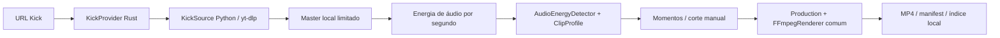

# Kick scoper

A integração Kick já foi integrada em main pelos PRs #1 e #2. O refactor de naming e responsabilidades continua na branch `kick_scoper`, num novo PR para main.

Executar `apps/chatscope/Setup-Kick.ps1` uma vez. Reutiliza o ambiente existente,
prepara as ferramentas comuns e instala curl-cffi, usado pelo extractor Kick do
yt-dlp. Não configura contas, cookies, OAuth ou um receiver público de webhooks.

O adapter aceita canais ao vivo, VODs específicos e clips. Rejeita playlists,
domínios parecidos, credenciais no URL, portas alternativas e IDs inválidos.
URLs são normalizados antes de chegarem ao worker.

VODs são analisados em intervalos até dez minutos, mantendo offsets absolutos.
Diretos gravam blocos de 30–600 s e usam tempos relativos ao master. Selecionar
um momento ou definir um intervalo permite produzir MP4 com o mesmo renderer,
formatos, legendas opcionais, cancelamento e recuperação da restante app.

Não há heatmap Kick nem captura de chat nesta versão. A API oficial de eventos
permitiria acrescentar chat por webhooks, mas exige infraestrutura pública e
configuração própria. O caminho atual funciona pelo vídeo/áudio disponível.
Picos de volume também podem ser música/ruído e precisam de revisão humana.

Sem áudio não são inventados candidatos; continuam possíveis cortes manuais.
Conteúdo removido, privado, offline ou bloqueado devolve erro. Um VOD antigo
da fixture upstream foi removido; para provas de rede usa-se um URL recente.

## Testes

- Rust: normalização de canais/VODs/clips, rejeição de entradas e capabilities reais.
- `tests/test_kick.py`: contratos de aquisição e tempos de live/VOD com media real
  sintética e apenas a rede simulada.
- `tests/kick-preview.mjs`: timeline de áudio, metadados seguros, corte manual,
  estados de ligação/cancelamento e layout compacto.
- `tests/media-network.mjs --url URL_DO_VOD`: caminho real CLI → Rust → Kick →
  master → MP4 vertical de cinco segundos, duração/dimensões/hash verificados.
- Acrescentar `--live` usa uma captura real limitada a 30 s, com tempos locais.

A disponibilidade dos canais e VODs muda. Provas de rede cobrem os URLs testados,
não todos os conteúdos da plataforma. A arquitetura geral e limites de produção
estão em [media-pipeline.md](media-pipeline.md).

## Provas reais em 25/11/2026

Um VOD já terminado de xqc e uma captura limitada a 30 s do canal ao vivo produziram MP4 verticais de cinco segundos com dimensão, duração e SHA-256 verificados. O primeiro VOD listado ainda estava em gravação e foi corretamente tratado como direto; escolheu-se o VOD terminado para a prova de offsets absolutos.

Teste nativo: node tests/kick-native.mjs URL_DO_VOD, com WebView2 oculto e rede real. Os tempos de live permanecem relativos ao master, sem prometer replay de chat ou heatmap.
