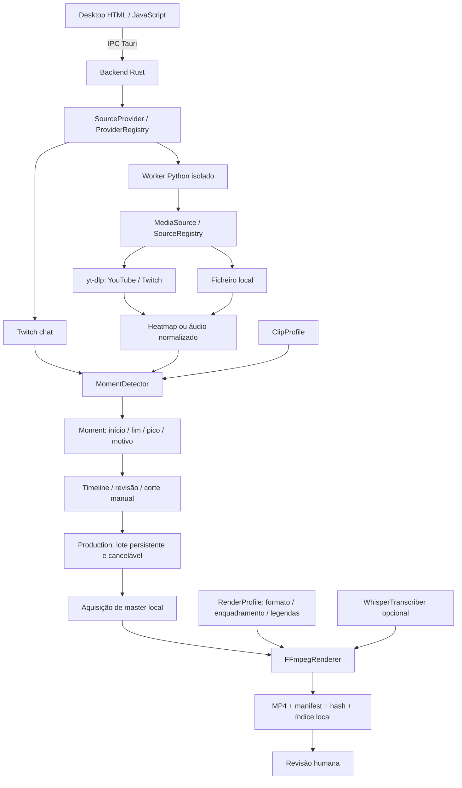

# Pipeline local de media

O desktop identifica momentos e cria MP4 locais. Publicação é uma operação
separada, nunca uma consequência de analisar ou renderizar.



## Responsabilidades

- `providers.rs`: `SourceProvider` valida/escolhe a origem. O resultado vídeo
  usa `scope::VideoAnalysis`, independente da plataforma.
- `scope.rs`: contratos `Source`, `SignalPoint`, `Moment`, `VideoAnalysis`.
- `detectors.rs`: `ChatActivityDetector`, `HeatmapDetector`, `AudioEnergyDetector`.
- `clips.rs`: `ClipProfile`, duração 5–180 s, contexto e máximo de candidatos.
- `media.rs`: lifecycle, protocolo JSON, cancelamento, persistência, recuperação,
  exclusão entre instâncias e `RenderProfile`.
- `pipeline/providers.py`: `MediaSource` é uma ABC; adquire ficheiros locais e
  devolve o offset original. O renderer não conhece URLs/plataformas.
- `pipeline/signals.py`: energia RMS do áudio por segundo, normalizada em dB.
- `pipeline/render.py`: `Renderer` / `FFmpegRenderer`, 1080×1920, 1920×1080 ou
  1080×1080, preservar imagem ou recorte central, áudio AAC normalizado.
- `pipeline/captions.py`: `Transcriber` / `WhisperTranscriber` opcional, idioma
  automático, SRT e transcrição; modelo carregado uma vez por lote.
- `pipeline/worker.py`: aplica pedidos, guarda masters, manifests, hashes e
  índice local. Não contém código de uploads.

Rust mantém coordenação e regras editoriais. Python reutiliza yt-dlp/Whisper.
FFmpeg é um processo especializado. A instalação existente `.venv-youtube`
é reutilizada. Os módulos Python ficam incorporados no executável e são
extraídos para uma runtime com hash. O protocolo usa stdin/stdout JSON, sem
shell ou servidor HTTP interno. Não se leem cookies pessoais automaticamente.

## Modos e limites

| Origem | Sinais | Aquisição/rendering |
| --- | --- | --- |
| YouTube gravado/processado | Heatmap; sem heatmap, áudio até 600 s | Download dos cortes escolhidos, render comum |
| YouTube Live | Captura local de 30–600 s; áudio | Cortes no master guardado, sem depender do futuro VOD |
| Twitch VOD/clip, modo chat | Chat | Clip usa offsets e vídeo do VOD original |
| Twitch, modo vídeo/áudio | Áudio do vídeo adquirido | Master local e render comum |
| Twitch live, modo chat | Apenas chat | Para MP4 usar modo vídeo/áudio ou coletor avançado `study/` |
| Ficheiro local | Áudio até 600 s; corte manual possível | Original preservado, render comum |
| Kick live / VOD / clip | Áudio do master, sem assumir chat/heatmap | Adapter kick_scoper; mesmo renderer e recuperação |

Num direto, tempos são relativos ao master local, não ao início do broadcast.
A captura termina após o bloco pedido; ainda não há buffer contínuo com rolling
storage. Novos blocos podem ser iniciados pela rotina. Sem heatmap, vídeos longos
devem ser analisados em intervalos até 600 s. Sem áudio, pode escolher corte manual.

Volume pode significar música/ruído. Não há classificação semântica de humor,
história ou qualidade. Nunca se fabricam candidatos para preencher o máximo.

## Produção e recuperação

Selecionar um momento preenche o corte, que pode ser ajustado. **Criar este MP4**
usa esse intervalo; **Criar todos os sugeridos** usa os momentos calculados com
o ClipProfile. `RenderProfile` define formato, enquadramento e legendas.

Só um lote escreve na pasta de produção de cada vez. Cada clip tem estado
`queued`, `acquiring`, `rendering`, `ready` ou `error`. O lote pode terminar
`complete`, `partial`, `error` ou `cancelled`. Ao reiniciar, trabalho em curso
fica `interrupted`. **Retomar incompletos** repete apenas os intervalos não
concluídos, num novo lote, preservando MP4 anteriores.

No Windows, um Job Object associa Python e filhos à app: cancelamento, timeout
ou fecho terminam também FFmpeg. Só se promove o MP4 final depois de verificar
formato/duração. Um erro não apaga outros clips. A escrita de estado é atómica
e tolera locks transitórios de Windows/OneDrive.

```text
media/daily/
  production.lock, current.json  exclusão de escrita e progresso
  requests/ID.json               pedidos para retoma
  cache/ID/                     masters de análise e proveniência
  runtime/HASH/                  módulos Python incorporados
  YYYY-MM-DD/
    clips/TEMA/ID-NN.mp4         entrega final
    jobs/ID/job.json             origem, perfis, cortes, estados, hashes
    jobs/ID/N/master/            media adquirida para o corte
    clips-index.md              índice gerado; preserva review.md humano
```

As datas usam Europe/Lisbon. Masters, transcrições e manifests permitem reedição.
Ainda falta uma política de retenção da cache; não se apagam originais ou
trabalhos anteriores automaticamente.

## CLI e rotina

`ChatScope.exe --media-job pedido.json` usa o mesmo pipeline. O JSON aceita
`url`, `start`, `end`, `captureSeconds`, `clipProfile`, `renderProfile`, `topic`,
`produce`, `output` e opcionalmente `outputRoot` e `moments` explícitos.
Tempos são números de segundos; `output` recebe o resultado JSON. A saída é
diferente de zero se a produção pedida ficar incompleta.

```json
{
  "url": "https://www.youtube.com/watch?v=YE7VzlLtp-4",
  "start": 0,
  "end": 120,
  "clipProfile": {"duration": 30, "beforePeak": 20, "maxMoments": 2},
  "renderProfile": {"aspect": "9:16", "fit": "pad", "captions": false},
  "topic": "animacao",
  "produce": true,
  "output": "resultado.json"
}
```

As automações Codex coordenam processos e o estado de `daily-clipping.md`;
não fazem parte do desktop nem garantem um modelo continuamente ativo. Usam
só as fontes indicadas para o dia, evitando repetir intervalos concluídos.
Upload é posterior, explícito e associado ao canal escolhido.

## Preparação e testes

`Setup-Media.ps1` instala yt-dlp com EJS, FFmpeg e tzdata no ambiente isolado.
Para YouTube, reutiliza Node do PATH para JavaScript. `-Captions` acrescenta
faster-whisper; o modelo small é descarregado só quando se pedem legendas.

- Rust: contratos, detectors, perfis, recuperação e exclusão entre instâncias.
- `tests/test_pipeline.py`: vídeo real sintético, áudio/silêncio, formatos,
  limites, falhas parciais, persistência e rendering de legendas com transcriber
  controlado. Não mede reconhecimento de fala real do Whisper.
- `tests/preview.mjs`, `tests/youtube-preview.mjs`: regressões da interface.
- `tests/media-native.mjs`: WebView2 oculto → IPC → Rust → Python → FFmpeg;
  MP4 verificado, cancelamento, retoma, reinício, hashes e layout compacto.
- `tests/youtube-native.mjs`: heatmap real, intervalos e cancelamento.

Provas de rede dependem de disponibilidade e não garantem cobertura de todos
os vídeos. Conteúdos indisponíveis ou bloqueados devolvem erros distintos.
